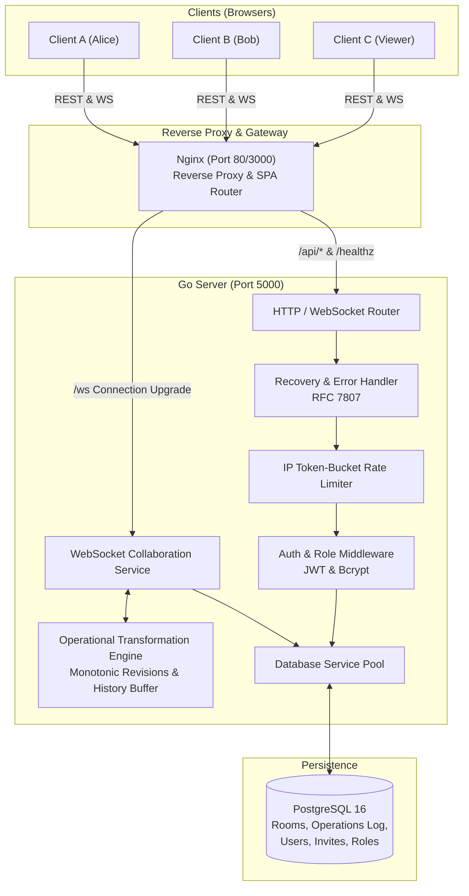

# Peeriodic 📝

**Peeriodic** is an enterprise-grade, real-time collaborative text editor built with a **Go** backend and **React/TypeScript** frontend. It provides Google Docs-style concurrent editing powered by **Operational Transformation (OT)**, live multi-user cursor tracking, per-document role-based access control (RBAC), and offline resilience.

---

## 🌟 Key Features

- **Operational Transformation (OT) Engine**: Rune-safe atomic transformation function $T(a, b)$ ensuring deterministic convergence across concurrent edits without loss of intention.
- **CodeMirror 6 Editor**: Rich markdown editor with syntax highlighting, line numbering, bracket matching, code folding, and collaborator cursor tags.
- **Real-Time Presence & Cursors**: Live avatar pills, assigned collaborator colors, selection highlighting, and live cursor position broadcasting.
- **Offline & Reconnection Resilience**: Unsaved local edits are queued in an in-memory client buffer (`ClientOTState`) when connectivity drops and automatically reconciled with the server upon reconnection.
- **Role-Based Access Control (RBAC)**: Fine-grained permissions (`Owner`, `Editor`, `Viewer`) with one-click cryptographic invite links and member management.
- **Document Dashboard**: Modern document browser with real-time title search, card grid previews, and creation modals.
- **Backend Hardening**: Zero-dependency structured logging (`log/slog`), RFC 7807 problem details, token-bucket IP rate limiting, and multi-stage graceful shutdown.
- **Automated Database Migrations**: Transaction-safe embedded SQL migrations (`backend/migrations/*.sql`) tracked via `schema_migrations`.
- **Production-Ready Containerization**: Multi-stage Alpine Dockerfiles, Nginx reverse proxy, and `docker-compose.yml`.

---

## 🏗️ Architecture



---

## 🚀 Quickstart

### Option 1: Docker Compose (Recommended)

Start PostgreSQL, the Go backend server, and the Nginx frontend SPA together:

```bash
# Clone the repository
git clone https://github.com/logoes0/peeriodic.git
cd peeriodic

# Copy environment template
cp .env.example .env

# Build and start all services in the background
docker-compose up --build -d
```

- **Frontend App**: [http://localhost:3000](http://localhost:3000)
- **Backend API**: [http://localhost:5000](http://localhost:5000)
- **Liveness Probe**: [http://localhost:5000/healthz](http://localhost:5000/healthz)
- **Readiness Probe**: [http://localhost:5000/readyz](http://localhost:5000/readyz)
- **Runtime Metrics**: [http://localhost:5000/metrics](http://localhost:5000/metrics)

---

### Option 2: Local Development with Make

#### Prerequisites
- **Go**: 1.22+
- **Node.js**: 18+ (Node 20+ recommended)
- **PostgreSQL**: 14+ running locally

```bash
# 1. Install dependencies
make install

# 2. Configure environment
cp .env.example .env
# Ensure DB_USER, DB_PASSWORD, and DB_NAME match your local Postgres setup

# 3. Start development servers
make run
```

Or run services individually:
```bash
# Backend with live reload
make run-be

# Frontend React dev server
make run-fe
```

---

## 🧪 Testing

Peeriodic includes unit tests, concurrency tests, and database integration tests.

```bash
# Run all backend and frontend test suites
make test

# Run backend tests only
cd backend && TMPDIR=/tmp go test -v -race ./...

# Run frontend tests only
cd frontend/client && npm test -- --watchAll=false
```

---

## ⚙️ Configuration Reference

| Environment Variable | Description | Default |
|---|---|---|
| `HOST` | Server bind address | `localhost` |
| `PORT` | Server listening port | `5000` |
| `DB_HOST` | PostgreSQL host address | `localhost` |
| `DB_PORT` | PostgreSQL port | `5432` |
| `DB_USER` | PostgreSQL user | `postgres` |
| `DB_PASSWORD` | PostgreSQL password | `postgres` |
| `DB_NAME` | Database name | `peeriodic` |
| `DB_SSLMODE` | PostgreSQL SSL connection mode | `disable` |
| `JWT_SECRET` | Secret key for signing authentication tokens | *Configurable* |
| `JWT_EXPIRY_HOURS` | Duration in hours before JWT token expires | `72` |
| `LOG_LEVEL` | Logging verbosity (`DEBUG`, `INFO`, `WARN`, `ERROR`) | `INFO` |
| `LOG_FORMAT` | Log layout: `text` (dev readable) or `json` (cloud/k8s) | `text` |
| `AUTO_MIGRATE` | Automatically apply embedded SQL migrations on startup | `true` |

---

## 📡 Collaboration Protocol & API

- **Operational Transformation & WebSocket Specification**: See [`PROTOCOL.md`](./PROTOCOL.md).
- **OpenAPI 3.1.0 Specification**: See [`docs/openapi.yaml`](./docs/openapi.yaml).

### Summary of WebSocket Messages

| Message Type | Direction | Description |
|---|---|---|
| `init` | Server $\to$ Client | Initial document snapshot, assigned client ID, color, role, and collaborator presence list. |
| `op` | Bidirectional | Atomic text operation (`insert` or `delete`) with base revision and client ID. |
| `ack` | Server $\to$ Client | Acknowledgment of applied client operations with updated server revision. |
| `cursor` | Bidirectional | Real-time cursor coordinates (`line`, `ch`, `pos`, `sel_start`, `sel_end`). |
| `presence` | Server $\to$ Client | Active room collaborators list with connection timestamps and user profiles. |
| `sync` | Bidirectional | Resynchronization request/response when client reconnects after network drop. |
| `ping` / `pong` | Bidirectional | Heartbeat monitoring connection liveness every 25 seconds. |

---

## 📄 License

This project is licensed under the MIT License. See [LICENSE](LICENSE) for details.